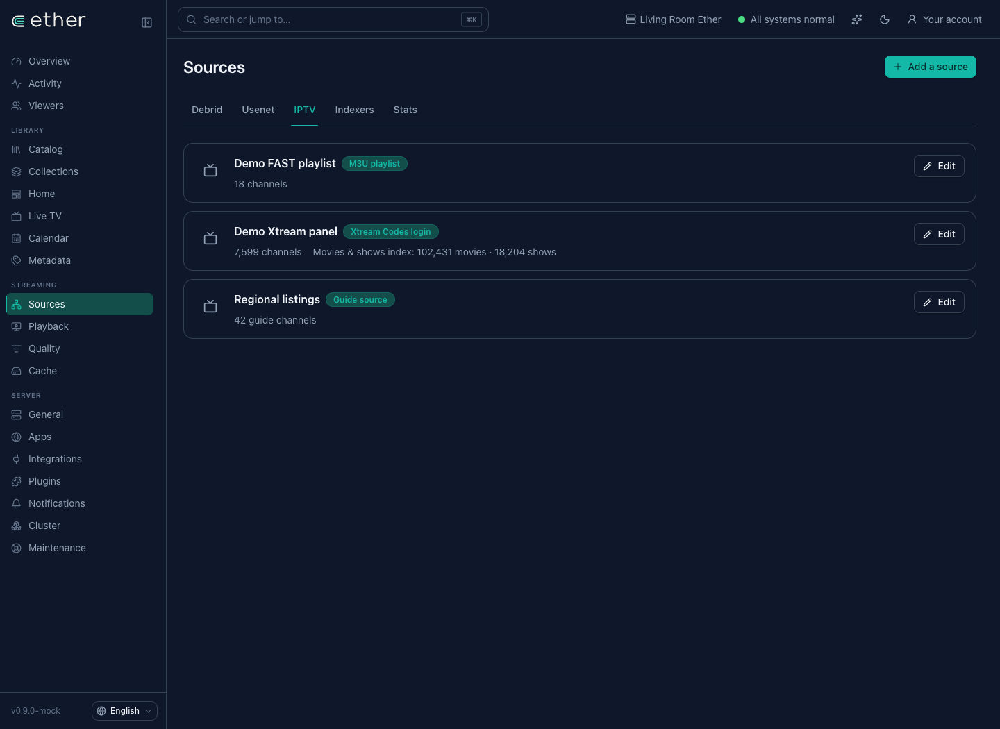
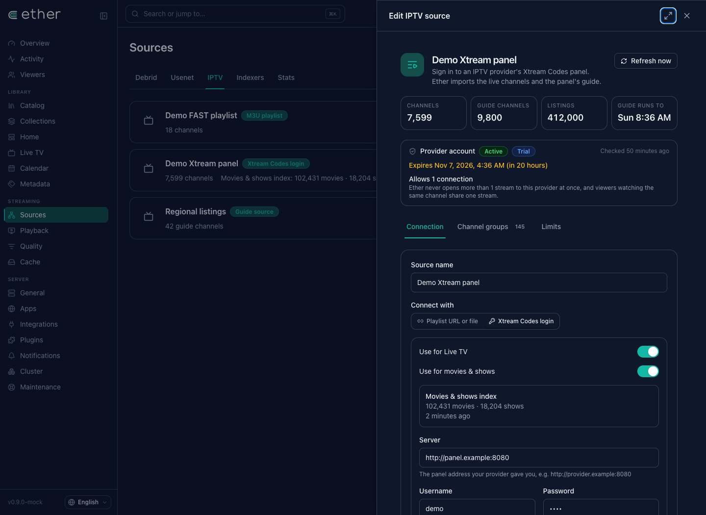
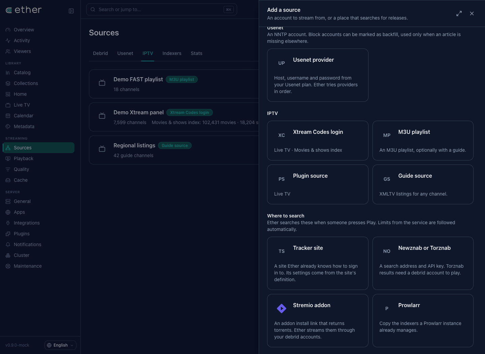
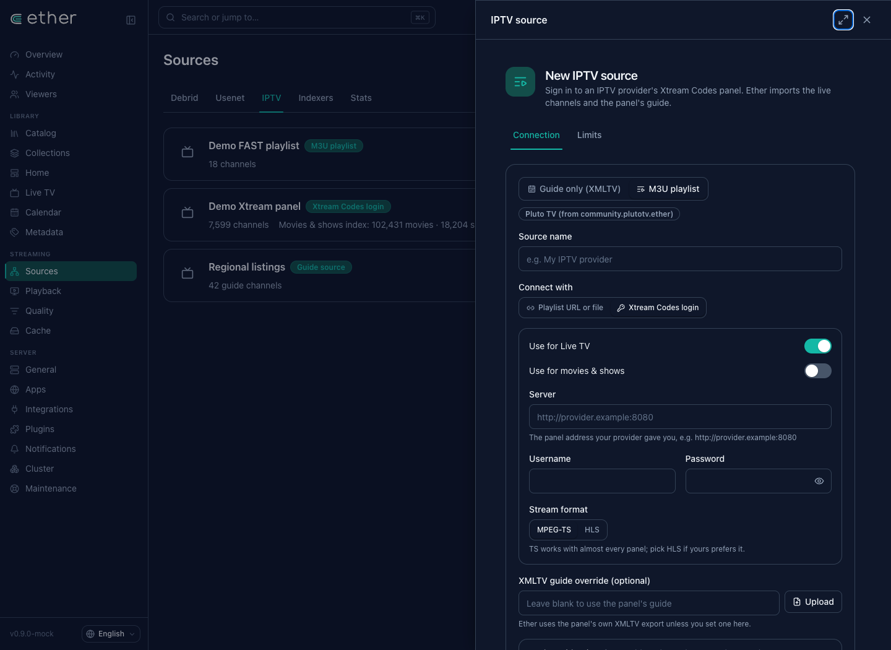
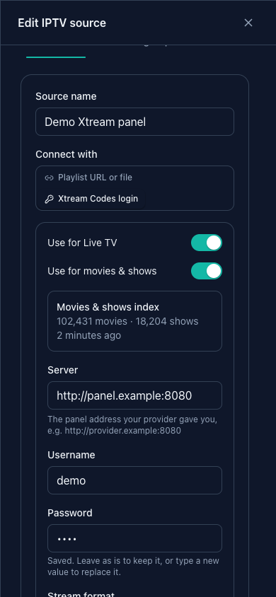
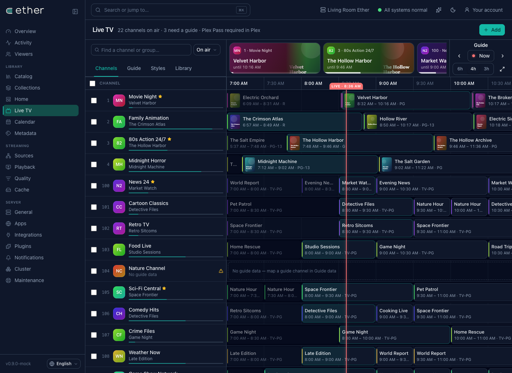

# Unified Sources — implementation and validation

This implements the owner's directive in coordinator message 43239: source setup has one home, **Sources**. It supersedes the earlier Live TV drawer layout. The owner has authorized continued implementation, integration and testing; these captures document the implemented layout.

## Navigation and ownership

- **Sources → IPTV** lists every existing provider, playlist, guide and channel-plugin source. These are the existing stored records and IDs, with the existing credential protection and provider connection budget. No connection is copied or migrated.
- **Sources → Add a source** includes Xtream, M3U playlists, guide sources and channel plugins alongside the other source types.
- The one Xtream editor has **Use for Live TV** and **Use for movies & shows**, plus index status/counts. Both uses share this connection.
- **Live TV** keeps channel programming, its lineup and guide mapping. Its separate Sources tab and source editor are removed. Contextual add/edit actions navigate to Sources; old `/livetv/sources` and `?source=…` links redirect to the same records there.
- Source status polling pauses while an editor is open, preserving the owner's unsaved draft.

The tab label is **IPTV**. Final integrated UI verification belongs to the release coordinator.

## One Sources page

## The shared provider connection

## One add-source gallery

## Add an Xtream connection here

## Mobile

## Live TV keeps channel work

## Evidence and limits

Captured from the running console mock at the plain HTTP LAN origin `http://192.168.68.65:5179/ether`. Counts are fixture data; these are the actual React screens. The preview and browser are stopped after capture.

- Typecheck and 58 focused Live TV/i18n tests pass, covering the canonical source editor reached through old links, saved credential placeholders, channel-group saves, plugin channel import and all 20 locales. The test DOM emits its existing unsupported video-method diagnostics; no assertions fail.
- Browser checks verify that the old source URL reaches `/sources/iptv?source=demo-xtream`, the Live TV Sources tab is absent, and a new Xtream form starts with an empty server field.
- The earlier backend fake-provider checks cover matching, ranking, HTTP Range/seek, shared connection limits, explicit provider busy, refresh rollback and credential-safe errors.
- Earlier one-off local SQLite measurements: 100,000 movies indexed in 2.43 seconds; unchanged refresh in 2.01 seconds. These are fixture timings, not remote-database/provider benchmarks.

The index learns provider identities and looks up details for matching catalogue requests. It does not create catalogue entries for every provider item. Missing identifiers require a normalized title and a verified matching year; uncertain matches are omitted.

Earlier screenshots 01–03 are retained as superseded draft history and are not the current proposal.

## Continuation checks

Focused checks additionally cover reopening a movies-only connection without stripping its Xtream login, trailing/truncated replies, cancellation rollback, credential rotation invalidation, and concurrent source edit/delete during refresh. The movie/Range/CRUD fixture and concurrent-edit/delete fixture pass on a temporary local PostgreSQL 16 instance as well as SQLite. Refresh stages streamed lists outside the database transaction, then takes the existing source-edit advisory lock and verifies the source snapshot before applying changes. Source failure status uses the same CRUD lock.

Provider connection admission is **process-local**. No account-wide cross-node connection lease has been implemented or verified. Provider list endpoints use the standard unpaginated Xtream arrays, streamed to bounded disk staging; nonstandard paginated envelopes are rejected rather than silently treated as a complete catalogue. No real provider or lab service was contacted.
