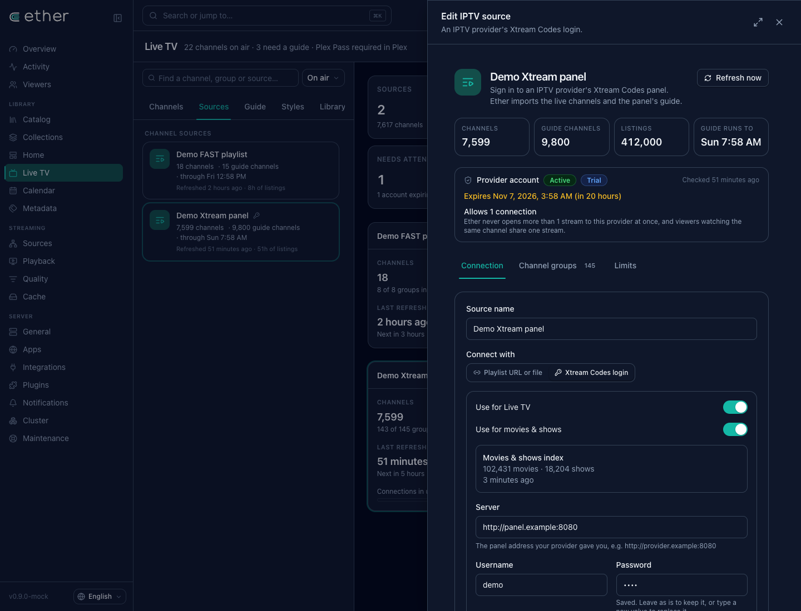
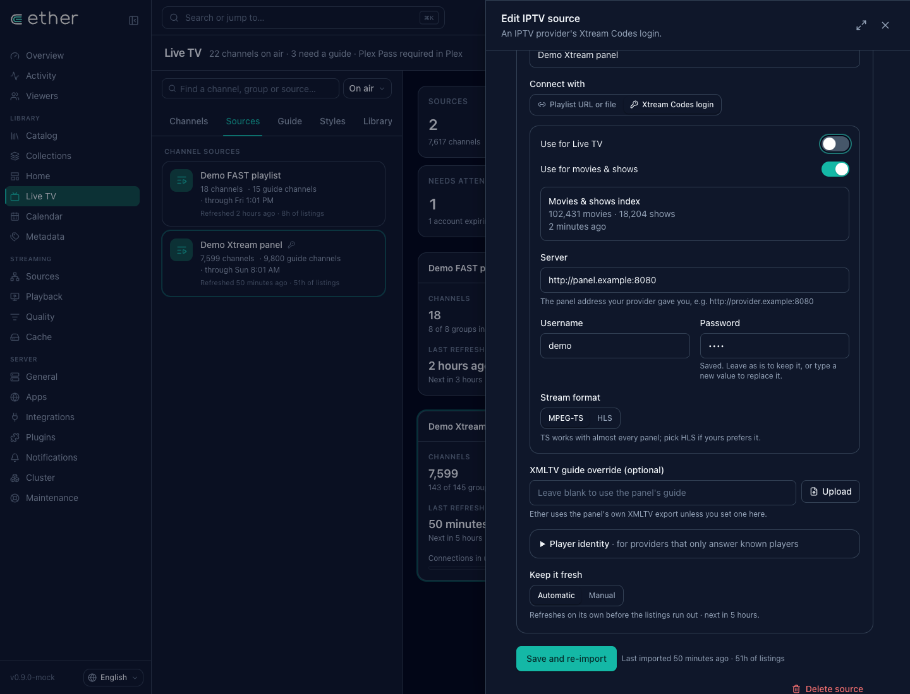
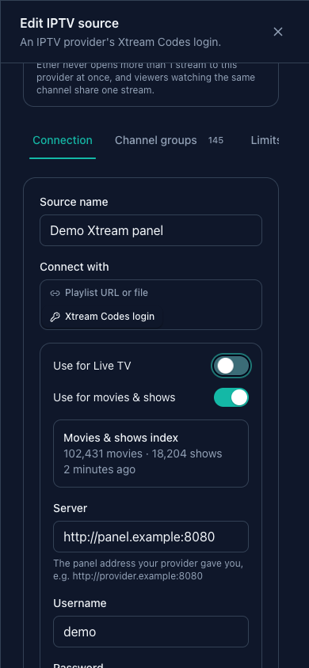

# Xtream provider source — console draft for owner approval

Captured from the running console mock on plain HTTP at `http://192.168.68.65:5179/ether/livetv/sources`. Counts are fixture data; screenshots show the real source editor. The temporary preview is stopped after capture.

The existing provider connection now carries both usage switches. Existing connections keep Live TV enabled and movies/shows disabled until the owner chooses otherwise. No second credential form is introduced.

## Live TV and movies/shows enabled — desktop

## Movies/shows enabled, Live TV disabled — desktop

## Movies/shows enabled — mobile (390 × 844)

Owner approval is pending; these console changes remain a draft.

## Verification

- Fake upstream provider: TMDB IDs, normalized title/year fallback, conflicting IDs, episode selection, cross-source ranking, Range reads and backward/forward seeks, one-connection budget shared with live taps, explicit busy resolution, incremental details, rollback on failed refresh, safe protocol errors.
- Focused existing live import/direct HTTP regression tests and app package compilation pass.
- Console typecheck and 30 i18n tests pass. New labels exist in all 20 locale catalogues; existing plural translations are preserved.
- One-off in-memory SQLite scale check: 100,000 movies indexed in 2.43 seconds, unchanged refresh in 2.01 seconds. The temporary scale test was removed after measurement to keep the lasting suite small. These are local fixture timings, not a remote database or provider benchmark.

The index stores provider titles and identities, then reads/caches VOD or episode details only for a matching catalogue request. It does not create catalogue entries for every provider item. Missing IDs require a normalized title and matching known year; uncertain matches are omitted.
